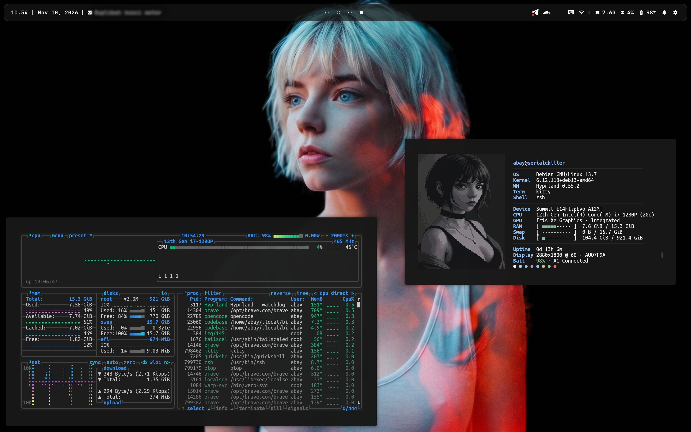
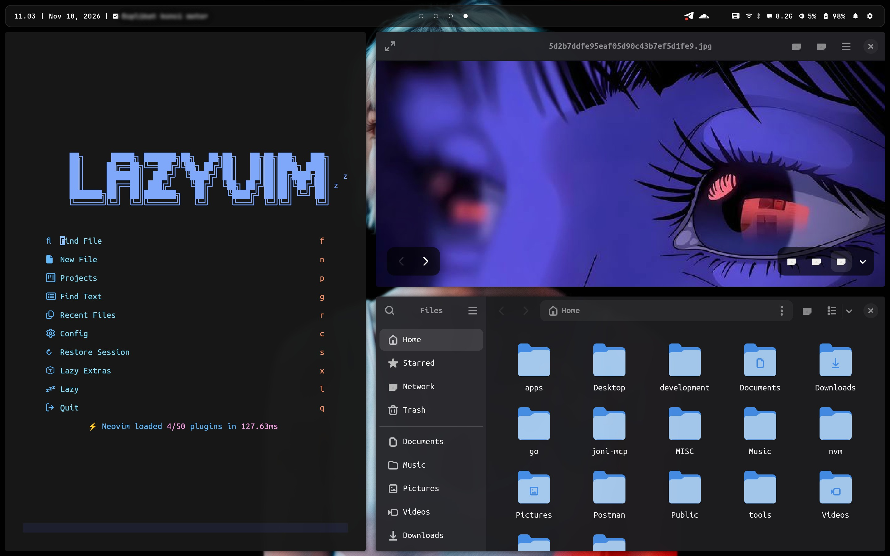

# dotfiles

Hyprland desktop on Debian with the "Serialchiller" theme (neutral dark, blue
accent) shared across Waybar, Kitty, btop, bat, fastfetch and GTK.

|  |  |  |
|---|---|---|

## Install

```bash
git clone https://github.com/opiniondealer/dotfiles.git
cd dotfiles
./install.sh
```

The script links every config into place, renders the machine-specific paths,
and ends with a dependency report plus a self-check. Existing files are moved to
`~/.dotfiles-backup/<timestamp>/` first. Safe to re-run.

It does **not** install packages — see [Prerequisites](#prerequisites).

## What's inside

**Desktop**

| Path | Contents |
|---|---|
| `hypr/` | Hyprland: keybinds, monitor profiles, workspaces, hyprpaper, hyprlock, hypridle, GTK theme |
| `waybar/` | Bar config for single and triple monitor setups, `style.css`, theme |
| `hyprdots/scripts/` | Helper scripts and panels the bar calls |
| `wofi/` | Launcher (`SUPER+Space`) |
| `quickshell-controlcenter/` | Control center, Bluetooth and WiFi popups, notification daemon |

**CLI / TUI**

`.zshrc` (Oh My Zsh, custom prompt, aliases, functions), `kitty/`, `nvim/`
(LazyVim), `bat/`, `btop/`, `fastfetch/`, `git/.gitconfig`, `bin/`,
`systemd/user/`.

**Legacy:** `swaync/` is kept for reference and masked — Quickshell owns
`org.freedesktop.Notifications`.

## Quickshell panels

Runs as a systemd user service.

| Panel | Opened by | What it does |
|---|---|---|
| Control center | `SUPER+C`, Waybar gear | Clock, toggles (WiFi, Bluetooth, DND, Gaming Mode), volume/brightness, CPU/RAM/DISK, notifications |
| Bluetooth | Waybar icon | Adapter power (unblocks rfkill first), scan, connect/disconnect |
| WiFi | Waybar icon | Radio toggle, scan, connect to saved/open networks, password dialog |

```bash
quickshell ipc -p ~/.config/quickshell-controlcenter call controlcenter toggle
systemctl --user restart quickshell-controlcenter
```

## Prerequisites

Debian trixie main:

```bash
sudo apt install waybar wofi kitty neovim python3 jq curl \
  pulseaudio-utils wireplumber brightnessctl network-manager rfkill \
  bluez blueman playerctl grim slurp wl-clipboard bat btop fastfetch \
  fonts-materialdesignicons-webfont
```

Debian trixie backports (Hyprland stack and Quickshell live here):

```bash
sudo apt install -t trixie-backports \
  hyprland hyprpaper hyprlock hypridle quickshell
```

`swaync` is not packaged at all — build it only if you want the legacy
notification config; Quickshell provides notifications.

**Fonts are not in apt.** `fonts-jetbrains-mono` exists but is *not* Nerd-patched,
so every glyph renders as a box. Download the patched build instead:

```bash
# https://github.com/ryanoasis/nerd-fonts/releases -> JetBrainsMono.zip
mkdir -p ~/.local/share/fonts && cd ~/.local/share/fonts
unzip ~/Downloads/JetBrainsMono.zip -d JetBrainsMonoNerd && fc-cache -f
```

`install.sh` checks all of these and prints what is missing with the package
that provides it.

## Known issue: no Bluetooth adapter kills the whole bar

Waybar 0.12.0 (Debian trixie) **segfaults** on the `bluetooth` module when the
machine has no `/dev/rfkill`, taking the whole bar down. Affects VMs, containers,
and laptops with Bluetooth disabled in BIOS.

Fix: remove `"bluetooth"` from `modules-right` in `waybar/config-single` and
`config-triple`. Waybar 0.13+ is not affected. A note sits next to the module.

<details>
<summary>How the install works</summary>

**Placeholders.** Some configs need absolute paths, and their consumers do not
expand `~` or `$HOME` (fastfetch, wofi), or must point at machine-specific files
(wallpapers). Those ship with placeholders:

| Placeholder | Replaced with |
|---|---|
| `__HOME__` | `$HOME` |
| `__WALLPAPER__` | `~/.cache/current_wallpaper`, or a generated 1920x1080 `#171717` PNG |

Rendered copies go to `~/.config/dotfiles-rendered/` and are symlinked into
place, so the repo stays portable. Affected: `fastfetch/config.jsonc`,
`wofi/config`, `wofi/drun.conf`, `waybar/config-single`, `waybar/config-triple`,
`hypr/hyprlock.conf`, `hypr/hyprpaper.conf`.

**Runtime symlinks.** `switch-layout.sh` rewrites these on every monitor
hotplug, so they are git-ignored and created by `install.sh`:

- `~/.config/hypr/monitors.conf`
- `~/.config/waybar/config`

Both scripts resolve the repo from their own real path, so any clone location
works.

**Verification.** The last step checks the result rather than trusting that the
commands ran: no leftover placeholders, every created symlink resolves, JSON
parses, Waybar module commands point at real files, fastfetch renders, the
systemd unit verifies. Failures print and the script exits non-zero. It is a
static check — it does not start Waybar or Hyprland.

</details>

<details>
<summary>Shell commands and aliases</summary>

| Command | Function |
|---|---|
| `mkdir namafolder` | Create directory and enter it |
| `cekip` | Public IP |
| `extract file.zip` | Universal extract (tar, zip, 7z, gz, xz) |
| `path` | Show all PATH entries |
| `reload` | Restart shell without closing the terminal |

Aliases: `..` `...` `....` (navigate up), `ll` → `ls -lah`, `vim` → `nvim`,
`cat` → `batcat`.

</details>